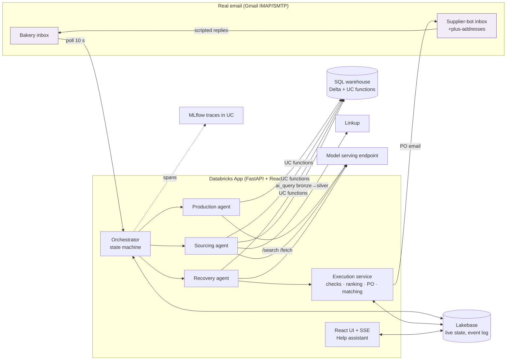

# crumbly — *A little less worry.*

An emergency purchasing agent for independent wholesale bakeries. When a supplier cancels or shortens a delivery,
Crumbly detects the email, works out exactly which bakes are at risk, emails approved suppliers and researches new ones
(Linkup), chases and follows up, validates every offer against the owner's rules, places the order (or asks), and
checks the supplier's confirmation field by field.

**Models interpret, code decides.** LLMs read emails and extract fields. Deterministic code (UC SQL functions + the
execution service) does every calculation, check and consequential action.



## Where each sponsor sits in the decision path

**Databricks**
- *Detect/Understand*: the agents' only data tools are **Unity Catalog SQL functions** (`calculate_shortage`,
  `get_affected_orders`, `get_approved_alternatives`, `coverage_by_slot`, `supplier_reliability`), called through the SQL
  warehouse with parameterised SQL. `coverage_by_slot` is a time-phased check (a 07:00 delivery can save the 07:00 bake
  but not the 06:00 one, with a 60-min buffer).
- *Coordinate*: every email lands in `bronze_emails`. Supplier replies become `silver_quotes` via SQL **`ai_query`**
  with a JSON response format. If that path fails or takes over 8 s, the app falls back to the LLM client, and records
  which path ran.
- *Decide*: reliability ranking comes from SQL over `delivery_history`, so 96% and 91% are computed, not constants.
- *State*: live state lives in **Lakebase** (Postgres), with an append-only event log. Persisting after every step means
  a crash resumes the incident instead of restarting it.
- *Observability*: there are **MLflow 3 traces** (stored in UC tables) per agent step and tool call, tagged with
  `incident_id` and grouped as one MLflow session per incident. Owner rejections are logged as human feedback.
- *Deployment*: the app ships as a **Databricks App** (`app.yaml`). Model calls go to a **serving endpoint**.

**Linkup**
- *Investigate*: the agent runs structured `/search` (depth `standard`, with sources) to discover suppliers near the
  postcode.
- *Verification*: each key claim (delivers to the area, sells the pack size, delivery time, trade minimum) is checked
  two ways. One is `/fetch` of the supplier's own trade page; the other is an independent search that excludes the
  supplier's domain. Each claim is then labelled **confirmed**, **conflicting** (both values kept) or **unverified**.
- *Coordinate*: when a supplier's emailed arrival time contradicts their published policy, the incident is flagged.
- **Privacy**: queries are built only from ingredient, pack size and postcode area. A test asserts that customer names,
  order IDs and recipes never reach Linkup.
- New suppliers can be researched and emailed automatically. **Buying from them always needs the owner's OK.**

## Run it locally (no credentials needed)

```bash
make install        # Python venv + frontend packages
make dev            # builds the UI and serves http://localhost:8000
make test           # 17 tests, fully offline
```

Defaults are offline:
- `DB_MODE=embedded`: a bundled Postgres via `pgserver`, so no Docker is needed.
- `WAREHOUSE_MODE=local`: a Postgres mirror of the Delta tables and UC functions.
- `EMAIL_MODE=memory`: in-process mailboxes.
- `LLM_PROVIDER=stub`: a regex test double.

Set `LINKUP_MODE=fixture` to use the bundled fictional Thames Grain research. In the UI, the **Demo workspace** menu
resets a scenario and sends the cancellation email.

## Run it for real

1. Copy `.env.example` to `.env` and fill it in. **Never commit `.env`.**
2. **Gmail**: two accounts, each with 2-Step Verification, an app password and IMAP enabled.
   - The bakery account is `EMAIL_BAKERY_*`.
   - The supplier-bot account is `EMAIL_SUPPLIERS_*`. Every supplier is a `+plus-address` of it.
   - Crumbly identifies suppliers from `In-Reply-To`/`References`, never from the `From` address.
3. **Databricks resources** to create:
   - A SQL warehouse (`DATABRICKS_WAREHOUSE_ID`).
   - A catalog and schema (`UC_CATALOG` / `UC_SCHEMA`). Then run `notebooks/01_setup_uc.py` or `make uc-setup`.
   - A Lakebase database. Add it to the app as a *Database* resource. Locally, set `PG*` vars plus `LAKEBASE_ENDPOINT`
     (Autoscaling) or `LAKEBASE_INSTANCE` (Provisioned).
   - A chat model serving endpoint (`LLM_ENDPOINT`), for example a Foundation Model API endpoint.
   - An MLflow experiment such as `/Shared/crumbly`, with `MLFLOW_UC_TRACES=1` and `MLFLOW_TRACING_SQL_WAREHOUSE_ID`.
     If UC trace storage is unavailable, tracing falls back to the experiment store and logs a warning.
   - App secrets for the Gmail addresses, app passwords and `LINKUP_API_KEY` (see `app.yaml`).
4. `make deploy`, or set `DB_MODE=lakebase WAREHOUSE_MODE=databricks LLM_PROVIDER=databricks EMAIL_MODE=gmail` and run
   `make dev`.

## Demo script (≈3 min at `DEMO_TIME_SCALE=60`)

1. Run `make reset SCENARIO=happy`, then `make send-cancellation`. The real Millers Supply email arrives, and within
   seconds the home page shows the matched email, **INC-0042** and the metrics strip.
2. **Understand**: 200 kg needed, 40 kg on hand, **160 kg short**, rounded up to **7 × 25 kg**. Three orders are at risk
   per bake slot, with the UC function trail shown.
3. **Investigate**: enquiries go to Borough Mill, Harrow & Sons and Wheatfield; Millers Supply is excluded. Linkup finds
   Thames Grain with claims marked confirmed, conflicting or unverified, plus clickable sources and the exact query used.
4. **Coordinate**: Borough's "Seven bags for £147. Delivery tomorrow." is missing the delivery charge and a time. Crumbly
   sends one templated follow-up, and the answer comes back: "£18 delivery. £165 total. With you by 05:00."
   - Harrow (09:00) and Thames (07:00) are too late, which `coverage_by_slot` shows.
   - Wheatfield gets chased, then dropped.
5. **Decide**: 7 of 7 checks pass, and the ranking puts reliability before cost. **PO-0087** goes out automatically under
   the £250 limit.
6. **Execute**: the confirmation matches 7 of 7 fields. On hand stays at 40 kg while 175 kg is on order, so all three
   orders are covered.
7. **Log**: the append-only events with MLflow trace ids, plus Replay and Export.
8. **Help assistant**: "Is tomorrow OK?" gets an answer built from tool calls, with no invented numbers.

Other scenarios:
- **`short_confirm`**: Borough confirms 6 bags, which is **not accepted**. The recommended fix is a 1-bag Harrow
  early-van top-up (04:45, £26), bringing the total to £170, and it passes every rule.
- **`new_supplier_wins`**: only Thames qualifies, and buying from them needs your approval.
- **`owner_rejects`**: auto-ordering is off. You say "Too expensive" to Borough, and Crumbly re-plans to a split order
  (Harrow early van + Wheatfield, £162). It then suggests the rule "Ask me before ordering flour over £150".

## What's real, what's a fallback

| Piece | Real path | Local fallback (offline default) |
|---|---|---|
| Live state | Lakebase via SDK OAuth credential | embedded Postgres (`pgserver`) / docker-compose |
| Operational data + tools | Delta + UC functions via SQL warehouse | Postgres schema `wh` with the same functions |
| Reply parsing | `ai_query` (8 s budget) | LLM client, same schema (path recorded) |
| LLM | serving endpoint (OpenAI-compatible) | `stub` regex test double |
| Email | Gmail IMAP/SMTP | in-process mailboxes |
| Linkup | live API (+ optional disk cache) | `fixture`: fictional Thames Grain (`.example` domains) |
| Traces | MLflow → UC tables | MLflow experiment store (local sqlite) |

Notes:
- New suppliers found by live research are emailed at a supplier-bot plus-address, never at the real business.
- The scripted bot only answers as the fictional Thames Grain.
- All money is `Decimal` and all times are Europe/London.
- LLM output is validated with Pydantic and retried once. After that, the field is marked missing, which triggers a
  follow-up.

## Layout

```
backend/   main.py (API, SSE, loops) · agents/ (orchestrator, production, sourcing, recovery, tools)
           execution/ (service: checks, ranking, POs, matching; quotes: arithmetic) · dbx/ (sql client, tables,
           uc_functions, pipeline, seed) · db/ (Lakebase + migrations) · email/ · research/ · llm/ · assistant/
           demo/ (reset, supplier_bot, clock) · tests/
frontend/  React + Vite + Tailwind (built into frontend/dist, served by FastAPI)
notebooks/ 01_setup_uc.py · 02_pipeline_demo.py · 03_trace_analysis.sql
```

## Status

**Verified locally (offline modes):**
- **Tests**: all 17 pass (`make test`).
  - The acceptance numbers: a 160 kg shortage; +175 kg at 05:00 covers every slot, while at 07:00 it covers none; 96% and 91% reliability, computed in SQL.
  - Pack rounding and the 7 execution checks.
  - Confirmation matching and PO idempotency.
  - The Linkup privacy rule.
  - All four scenarios, end to end.
  - Crash-resume.
  - The assistant never ordering without a click.
- **Live server**: the `happy` scenario resolves end to end at 60× in about 40 s, and every event carries an MLflow trace id.
  - `short_confirm` produces a mismatch decision, and the top-up resolves it.
- **UI**: all screens were rendered in headless Edge with no console errors.

**Written to the current docs but not yet run against real services:**
- Lakebase OAuth credentials.
- The Databricks SQL warehouse client and UC function DDL.
- `ai_query` parsing.
- The serving-endpoint LLM.
- Gmail IMAP/SMTP.
- Live Linkup calls.
- MLflow traces in UC.
- The Databricks App deploy.

## Next steps

### 1. Credentials and resources needed
- [ ] **Databricks workspace**:
  - `DATABRICKS_HOST`, plus a PAT for local dev (Apps use their service principal).
- [ ] **SQL warehouse**: its ID goes in `DATABRICKS_WAREHOUSE_ID` and `MLFLOW_TRACING_SQL_WAREHOUSE_ID`.
- [ ] **Unity Catalog**: a catalog and schema (`UC_CATALOG` / `UC_SCHEMA`).
  - The app identity needs `USE CATALOG`, `USE SCHEMA`, `CREATE TABLE` and `CREATE FUNCTION`.
  - For trace tables it needs explicit `SELECT` and `MODIFY`.
- [ ] **Lakebase database**: either `LAKEBASE_ENDPOINT` (Autoscaling) or `LAKEBASE_INSTANCE` (Provisioned).
  - Add it to the app as a *Database* resource.
- [ ] **Model serving endpoint**: a chat model that supports `response_format` JSON schema and tool calling, set in `LLM_ENDPOINT`.
- [ ] **MLflow experiment**: an absolute path, e.g. `/Shared/crumbly`.
- [ ] **Two Gmail accounts**, each with 2-Step Verification, an app password and IMAP enabled.
  - These fill `EMAIL_BAKERY_*` and `EMAIL_SUPPLIERS_*`.
- [ ] **Linkup API key**: `LINKUP_API_KEY`.
- [ ] **App secrets**: store the Gmail and Linkup secrets as Databricks App secrets, matching the `valueFrom` keys in `app.yaml`.

### 2. Bring-up order (switch one integration at a time and re-run `happy`)
1. **Warehouse**: `WAREHOUSE_MODE=databricks`, then run `notebooks/01_setup_uc.py`.
   - Check `calculate_shortage` returns 160 and the `coverage_by_slot` cases match the tests.
   - **Watch for**: timestamp parameter types in `databricks-sql-connector`, and `DEFAULT` parameters in table functions.
2. **LLM**: `LLM_PROVIDER=databricks`.
   - Confirm the scripted emails parse identically to the stub, including Harrow's two offers.
   - Then confirm `ai_query` runs (`parse_path = ai_query` in `silver_quotes`).
   - **Watch for**: `responseFormat` being passed as a parameter. If that fails, inline it as a literal; the response format is a constant.
3. **Lakebase**: `DB_MODE=lakebase`. Confirm the credential refresh works and migrations apply.
4. **Gmail**: `EMAIL_MODE=gmail`.
   - Run `make send-cancellation`.
   - Confirm plus-address replies thread correctly and a supplier is never identified by its `From` address.
5. **Linkup**: `LINKUP_MODE=live`.
   - Check the structured discovery output.
   - Turn on `LINKUP_CACHE=1` before demo day so the demo is repeatable.
6. **Tracing**: `MLFLOW_UC_TRACES=1`.
   - Confirm one session per incident.
   - Fix the column names in `notebooks/03_trace_analysis.sql` after its `DESCRIBE` step.
7. **Deploy**: `make deploy`, then repeat the demo inside the App.

### 3. Before submission
- [ ] Run `happy` and `short_confirm` end to end, three times each, from `make reset`.
- [ ] Record the backup video.
- [ ] Optional (first on the cut list): an AI/BI dashboard over `incident_events_history` and the trace tables.
- [ ] Optional: tune the demo copy for the judges.
  - Example: show business-time durations in metrics. "Time to recover" currently uses wall-clock minutes, so it is compressed at 60×.
