# crumbly ~ *A little less worry.*

**An autonomous purchasing agent for independent wholesale bakeries.** When a supplier cancels a delivery the night
before a bake, Crumbly reads the email, works out exactly which customer orders are at risk, asks approved suppliers
for replacements, researches new ones with Linkup, chases missing details, checks every offer against the owner's
rules, places the order (or asks first), and then checks the supplier's confirmation field by field.

> Imperial AI Hackathon · **Autonomous Agents** track · Databricks and Linkup bounties

**[▶ Watch the demo video](demo/crumbly-demo.mp4)** · [Screenshot overview](docs/overview/)

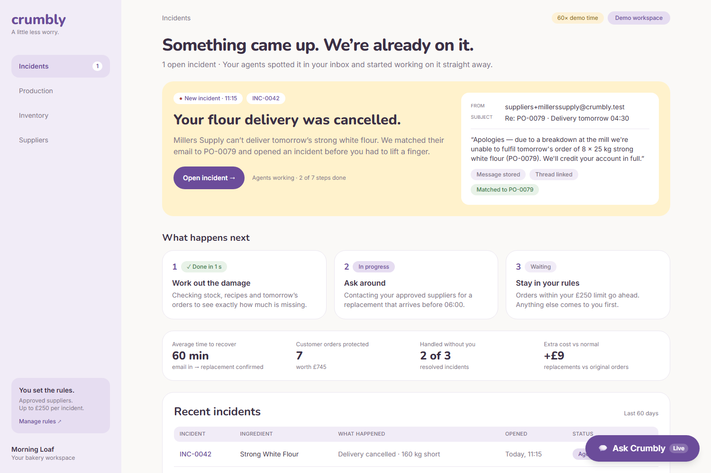

## For judges: the 60-second version

| Judging criterion | Where to look |
|---|---|
| **Does it work?** | All four scenarios run end to end in 36–69 s. `make test` passes 26 offline tests and ends with a plain-English checklist of what they prove. `make smoke` drives all four scenarios through the live HTTP API and times them. |
| **Technical depth** | Four agents and a state machine. **Unity Catalog SQL functions** are the agents' only data tools. **Linkup** handles discovery plus two-source claim verification. Confirmations are matched field by field. Purchase orders are idempotent, and the app resumes after a crash. |
| **Usefulness** | Independent bakeries have no procurement team. One cancelled flour delivery puts a café, a shop and a hotel's morning orders at risk. Crumbly sorts it out in about a minute, and the owner never needs to open their inbox. |
| **Originality** | **Models interpret, code decides.** LLMs only read emails. Deterministic code does every calculation, rule check and purchase. The agent can buy on its own, but only within rules the owner sets. |

The demo story is a fictional bakery, **Morning Loaf**. Millers Supply cancels tomorrow's 8 × 25 kg of strong white
flour. Crumbly finds the bakery is **160 kg short (7 bags)**, which would hit three customer bakes at 06:00, 06:30 and 07:00.

## Watch it work

Every screenshot below is captured from the running application; nothing is mocked up.

### 1. Detect: the cancellation email becomes an incident

Crumbly matches the supplier's email to the original order (PO-0079) and opens incident INC-0042 within seconds. The
owner doesn't have to do anything.

### 2. Understand: exact impact, calculated rather than estimated

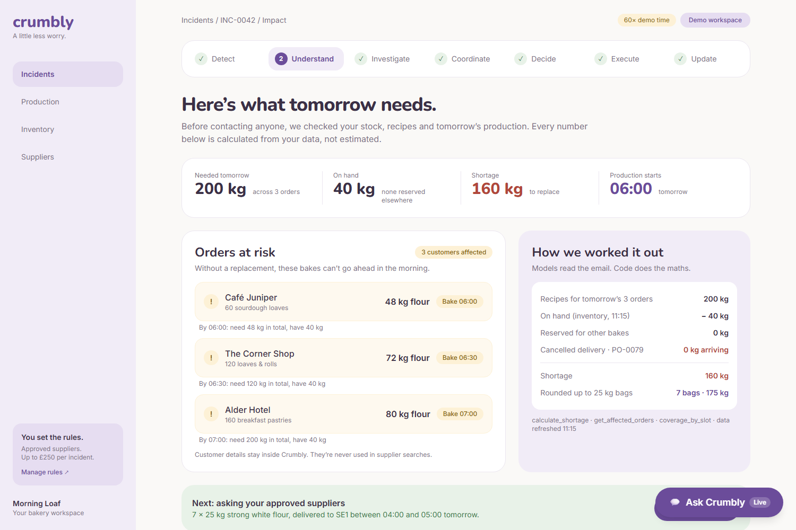

The 200 kg needed, 40 kg on hand and 160 kg shortage come from Unity Catalog functions (`calculate_shortage`,
`get_affected_orders`, `coverage_by_slot`), and the function trail is shown on the page. The shortage is rounded up to
whole 25 kg bags, and each bake slot is checked separately.

### 3. Investigate: approved suppliers plus Linkup research

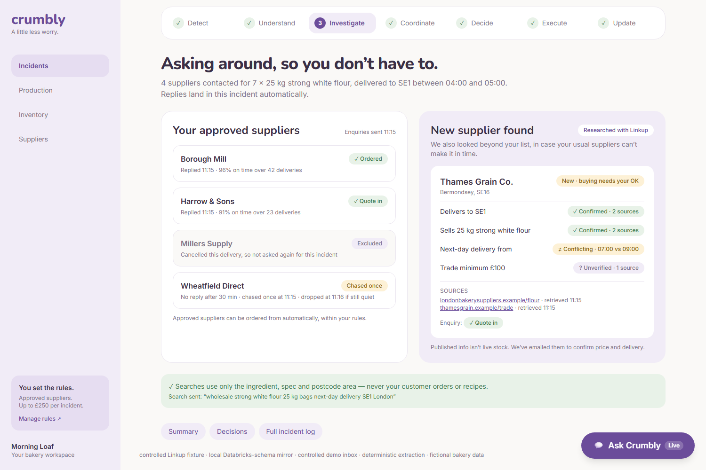

Crumbly emails the three approved suppliers and leaves out the one that just cancelled. At the same time, **Linkup**
finds a new supplier, Thames Grain Co. Crumbly checks each claim about Thames Grain against the supplier's own page and
an independent source, then marks it ✓ confirmed, ≠ conflicting or ? unverified. The exact search query is shown, and
it never includes customer names, order IDs or recipes. A test enforces that rule.

### 4. Coordinate: an incomplete quote gets a follow-up

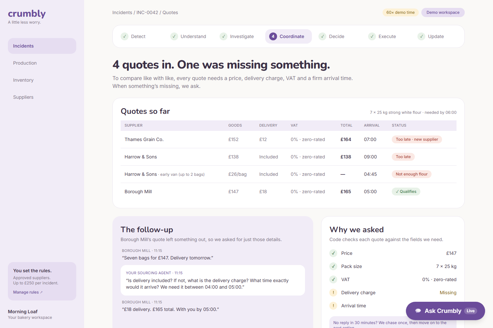

Borough Mill replies "Seven bags for £147. Delivery tomorrow.", with no delivery charge and no time. Code spots the
missing fields, and the agent sends one targeted follow-up. Suppliers that don't reply are chased once and then dropped.

### 5. Decide: every check is done by code

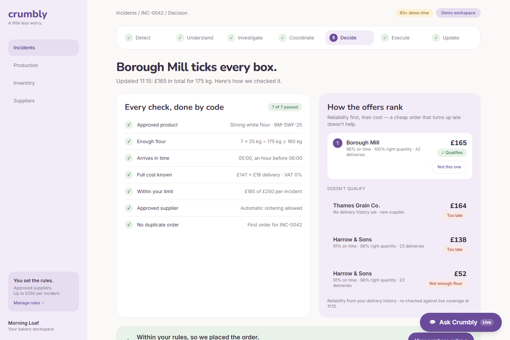

Each offer goes through seven deterministic checks: approved product, enough flour, arrives in time, full cost known,
within the spending limit, approved supplier and no duplicate order. Offers are ranked by reliability first, using
delivery history computed in SQL, and cost second. A cheap delivery that arrives late doesn't help.

### 6. Execute: the supplier's confirmation is checked, not trusted

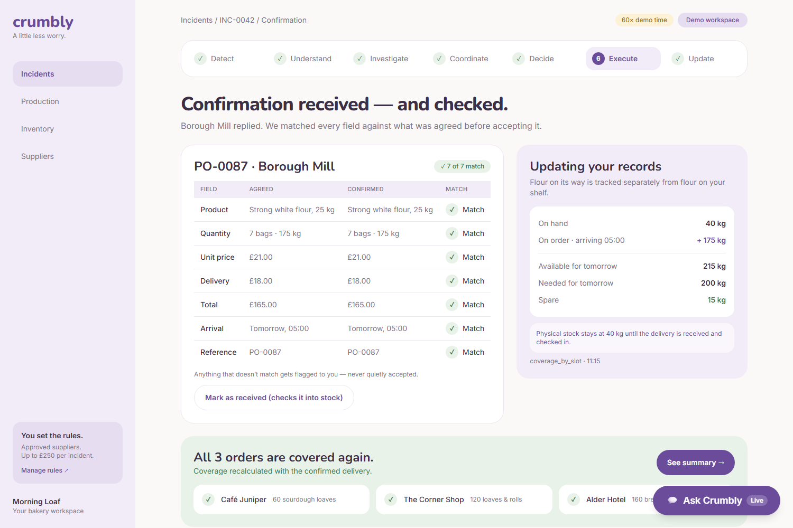

### 7. Update: the outcome, and a full audit trail

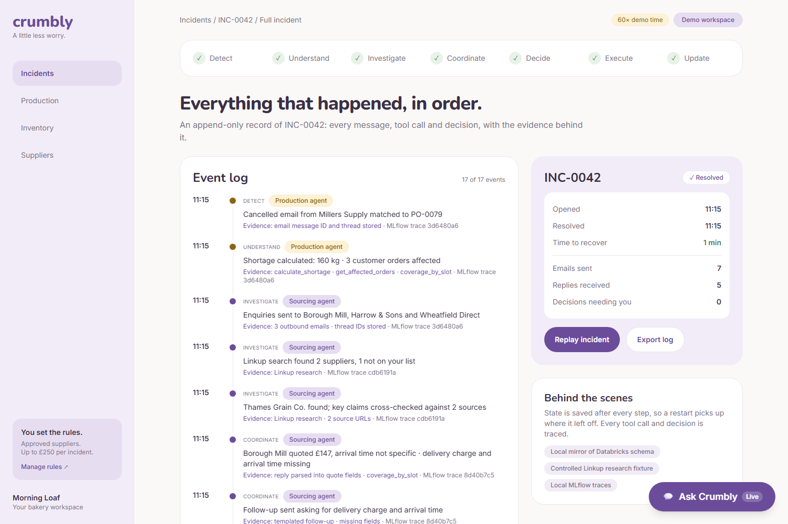

Every step is written to an append-only event log, with its evidence and an MLflow trace id. State is saved after every
step, so a restart picks up where it left off.

### Ask Crumbly: an assistant that can't spend money

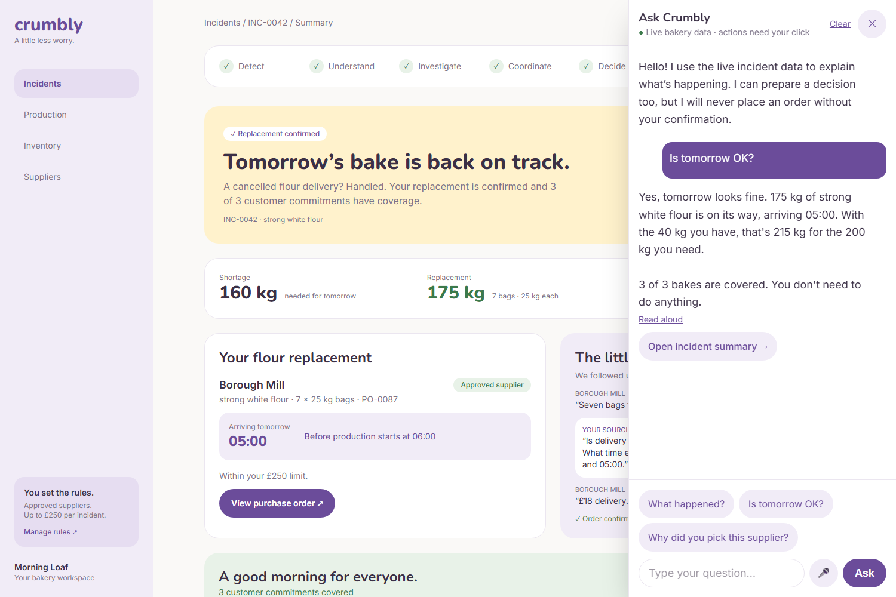

The assistant answers from read-only tools, so it can't invent numbers. It can prepare a decision, but placing orders,
sending emails and changing rules always need the owner's click. A test enforces this too.

## Four scenarios, four kinds of autonomy

Choose a scenario from the **Demo workspace** menu, top right, then click **Start demo**. Timings are measured at 60× demo
time, where a 30-minute supplier chase takes 30 seconds.

| Scenario | What happens | What it proves | Time |
|---|---|---|---|
| `happy` | Borough Mill qualifies after one follow-up. Crumbly orders by itself within the £250 limit. | It acts alone, but only within the owner's rules | ~38 s |
| `short_confirm` | Borough Mill confirms **6 bags, not 7**. Crumbly refuses to accept it and suggests a 1-bag top-up. | It checks what the supplier actually confirms | ~43 s |
| `owner_rejects` | Auto-ordering is off, and the owner rejects the offer as "Too expensive". Crumbly replans a split order and suggests a new rule. | The owner stays in control, and Crumbly learns from feedback | ~36 s |
| `new_supplier_wins` | Only the supplier Linkup found can deliver in time, so buying from it waits for the owner's OK. | The web research matters, and Crumbly is honest about what it couldn't confirm | ~69 s |

### `short_confirm`: Borough Mill confirms the wrong quantity

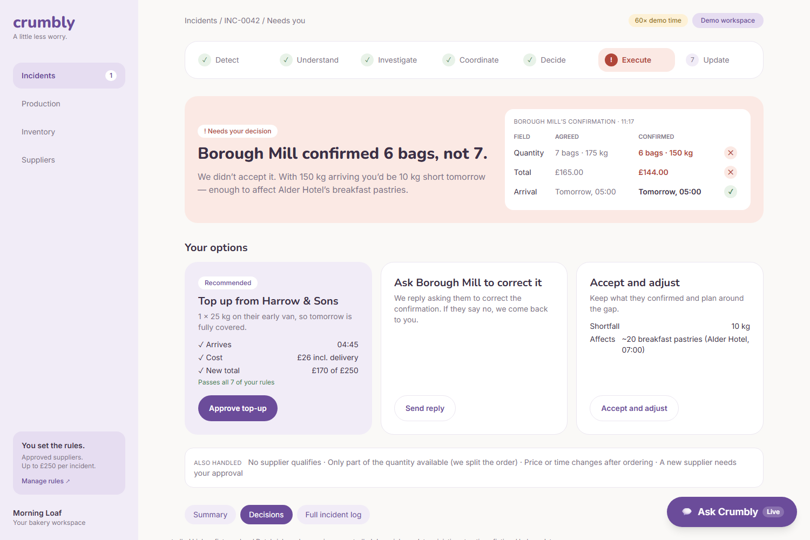

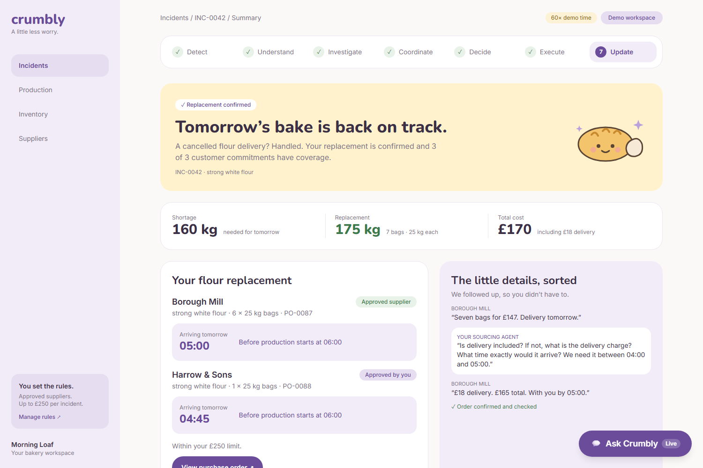

### `new_supplier_wins`: a supplier found on the web, bought from only with the owner's OK

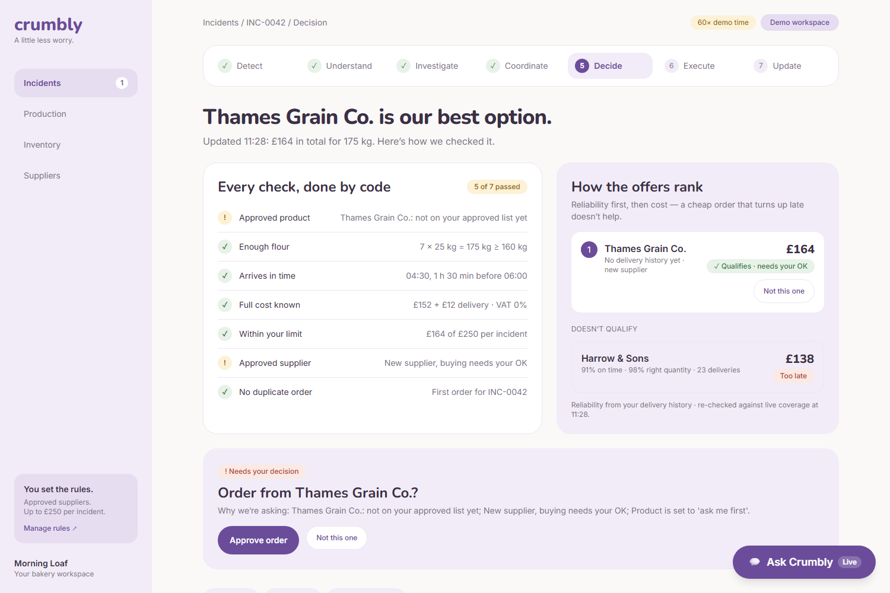

### `owner_rejects`: the owner says no and Crumbly replans

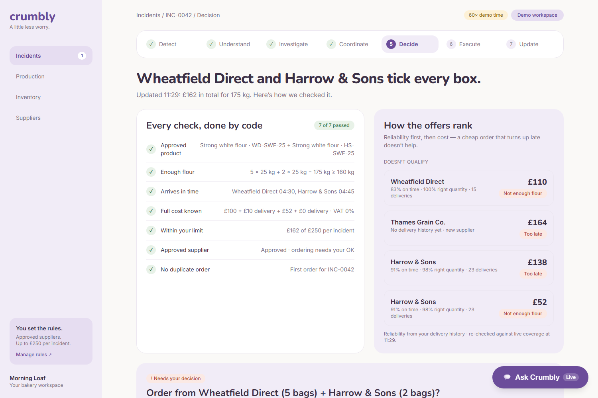

### The owner sets the rules, and Crumbly works within them

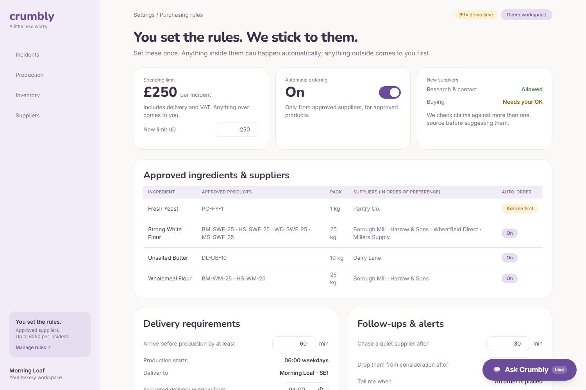

<details>
<summary>More screens: home after resolution, tomorrow's production</summary>

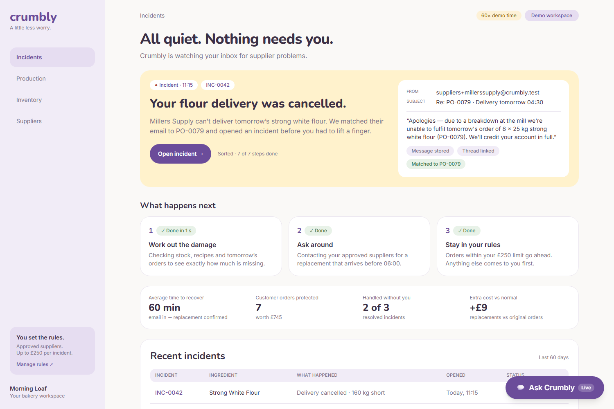
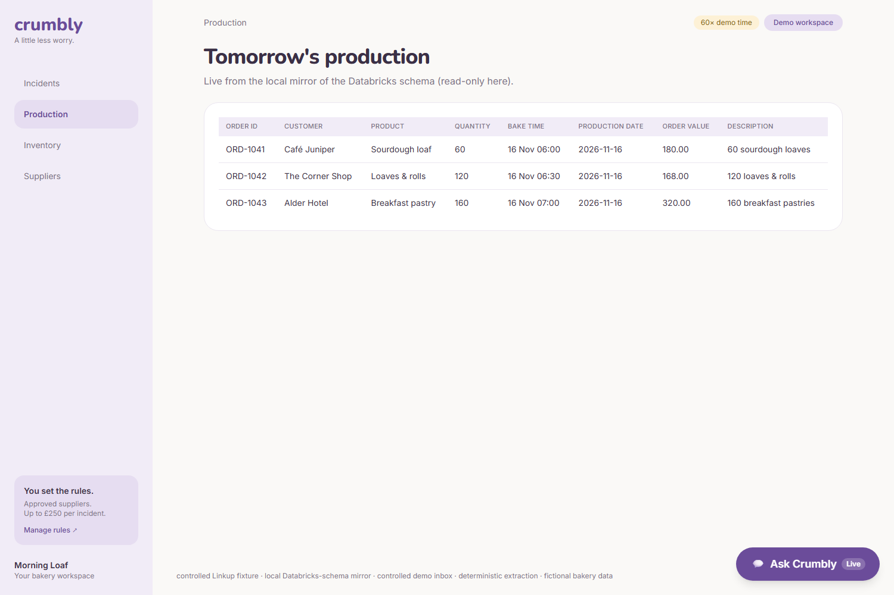

</details>

## How it works

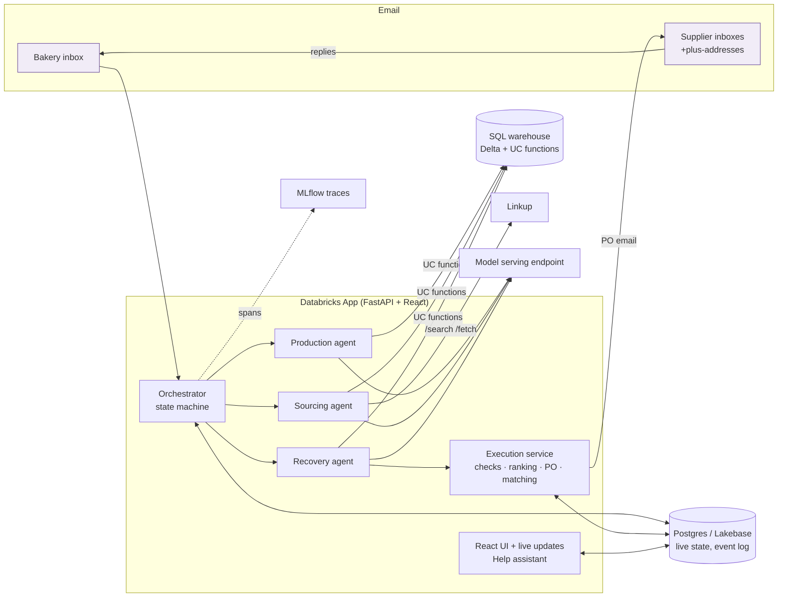

### Where each sponsor sits in the decision path

**Databricks**
- The agents' only data tools are **Unity Catalog SQL functions**: `calculate_shortage`, `get_affected_orders`,
  `get_approved_alternatives`, `coverage_by_slot` and `supplier_reliability`. They're called with parameterised SQL
  through the SQL warehouse.
- `coverage_by_slot` is time-phased. A 07:00 delivery can save the 07:00 bake but not the 06:00 one, allowing a 60-minute buffer.
- Reliability rankings such as 96% and 91% are computed in SQL from `delivery_history`, not hard-coded.
- Supplier replies flow from `bronze_emails` to `silver_quotes` through `ai_query`. If that fails, an LLM client
  fallback takes over, and the path used is recorded.
- MLflow traces are recorded for each agent step and tool call, grouped into one session per incident. The app is
  packaged to run as a Databricks App (`app.yaml`).

**Linkup**
- `/search` finds suppliers near the bakery's postcode.
- Each key claim is checked two ways: by fetching the supplier's own trade page, and by an independent search that
  excludes the supplier's domain. Each claim is then labelled **confirmed**, **conflicting** (both values kept) or
  **unverified**.
- If a supplier's emailed arrival time contradicts its published policy, the incident is flagged.
- **Privacy:** queries contain only the ingredient, pack size and postcode area. New suppliers can be researched and
  emailed automatically, but **buying from them always needs the owner's OK.**

### Safety rails

- Money is handled as `Decimal`, and all times are in Europe/London.
- LLM output is validated with Pydantic and retried once. If it still fails, the field is marked missing, which
  triggers a follow-up email instead of a guess.
- Purchase orders and emails are idempotent, so a retry or restart never sends a second order.
- Suppliers are identified from email threading (`In-Reply-To` / `References`), never from the `From` address.

## What's real and what's a stand-in

Transparency is a design principle. The demo uses deterministic local stand-ins so that every run is repeatable, and
the footer of every screen states which mode is active.

| Piece | Verified against the real service | Demo / offline stand-in |
|---|---|---|
| Delta tables + UC functions | ✅ Databricks Free Edition SQL warehouse, `crumbly.bakery` schema seeded. The live check returned 200 needed, 40 on hand, 160 short, 7 bags | Postgres schema `wh` with the same functions |
| Linkup | ✅ Live discovery and source-page verification, with customer data excluded | Bundled fixture with fictional Thames Grain (`.example` domains) |
| Live state | Code written for Lakebase, not yet run against it | Embedded Postgres (`pgserver`), no Docker needed |
| Email | Code written for Gmail IMAP/SMTP, not yet run against it | In-process mailboxes plus a scripted supplier bot |
| LLM | Code written for a serving endpoint and `ai_query`, not yet run against them | Deterministic regex extractor |
| Tracing | MLflow → UC tables not yet run | Local MLflow experiment store |

No real supplier is ever emailed. Demo suppliers route to a scripted supplier mailbox, and all bakery and customer
data is fictional.

## Run it yourself (no credentials needed)

```bash
make install        # Python venv + frontend packages
make dev            # builds the UI and serves http://localhost:8000
make test           # 26 offline tests, ending with a "What these tests prove" checklist
make smoke          # with `make dev` running: drives all four scenarios and times them
```

With no `.env` file, `make dev` starts demo-ready: demo time runs at 60× and the Linkup fixture is used. In the app,
open **Demo workspace**, pick a scenario and click **Start demo (reset + trigger)**.

On Windows without `make`, run these instead: `.venv/Scripts/python -m pytest` to test, and
`DEMO_TIME_SCALE=60 LINKUP_MODE=fixture .venv/Scripts/python -m uvicorn backend.main:app --port 8000` to serve.

### What the tests cover

All 26 pass offline, using embedded Postgres, in-memory mail, the stub LLM and the Linkup fixtures.
- The acceptance numbers: a 160 kg shortage; +175 kg arriving at 05:00 covers every slot, while at 07:00 it covers none; 96% and 91% reliability computed in SQL.
- Rounding up to whole bags, all seven execution checks, confirmation matching and purchase-order idempotency.
- The Linkup privacy rule.
- All four scenarios end to end, crash-resume, and the assistant never ordering without a click.
- Regressions found while preparing the demo: checking a delivery into stock, assistant phrasing, and glossary terms.

<details>
<summary>Connecting the real services</summary>

1. Copy `.env.example` to `.env` and fill it in. **Never commit `.env`.**
2. **Databricks:**
   - a SQL warehouse (`DATABRICKS_WAREHOUSE_ID`)
   - a catalog and schema (`UC_CATALOG` / `UC_SCHEMA`), then run `make uc-setup` or `notebooks/01_setup_uc.py`
   - a Lakebase database (`LAKEBASE_ENDPOINT` or `LAKEBASE_INSTANCE`)
   - a chat serving endpoint (`LLM_ENDPOINT`)
   - an MLflow experiment, e.g. `/Shared/crumbly`
3. **Gmail:** two accounts (the bakery and the supplier bot), each with 2-Step Verification, an app password and IMAP enabled.
4. **Linkup:** `LINKUP_API_KEY`, with `LINKUP_MODE=live`.
5. Switch one integration at a time and re-run `happy` after each:
   `WAREHOUSE_MODE=databricks`, `LLM_PROVIDER=databricks`, `DB_MODE=lakebase`, `EMAIL_MODE=gmail`. Then run `make deploy`.

</details>

## Repository layout

```
backend/   main.py (API, live updates, loops) · agents/ (orchestrator, production, sourcing, recovery, tools)
           execution/ (checks, ranking, POs, confirmation matching) · dbx/ (SQL client, Delta tables, UC functions,
           pipeline, seed) · db/ (Postgres/Lakebase + migrations) · email/ · research/ (Linkup) · llm/ · assistant/
           demo/ (reset, supplier bot, clock, smoke) · tests/
frontend/  React + Vite + Tailwind (built into frontend/dist and served by FastAPI)
notebooks/ 01_setup_uc.py · 02_pipeline_demo.py · 03_trace_analysis.sql
docs/screenshots/  the images in this README (1500 × 1000 PNG, captured from the running app)
```

More detail: [`DEMO_RUNBOOK.md`](DEMO_RUNBOOK.md) (how to run the demo), [`SUBMISSION_PACK.md`](SUBMISSION_PACK.md)
(the submission write-up) and [`NON_HAPPY_DEMO.md`](NON_HAPPY_DEMO.md) (the edge-case scenarios).
